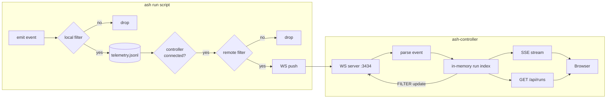
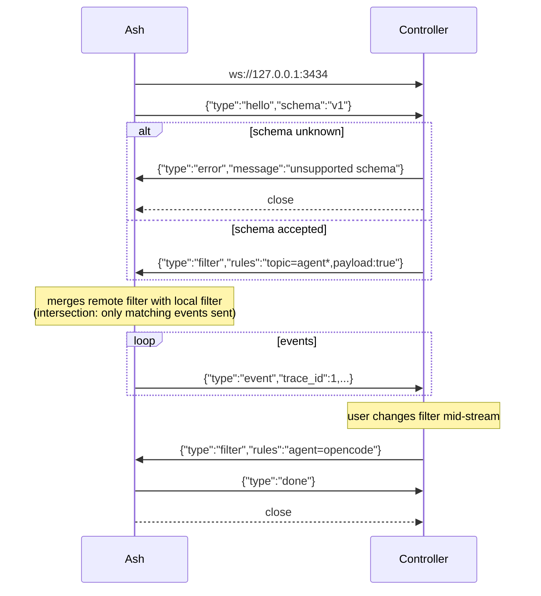
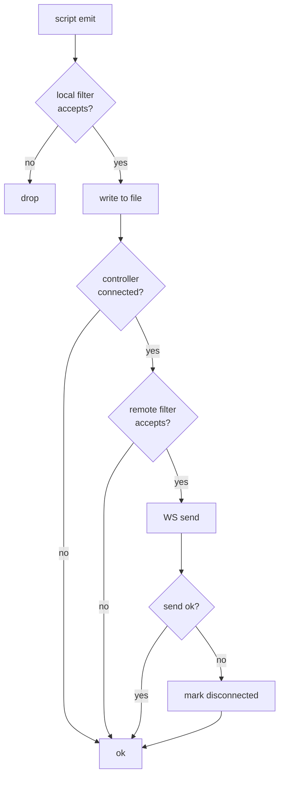
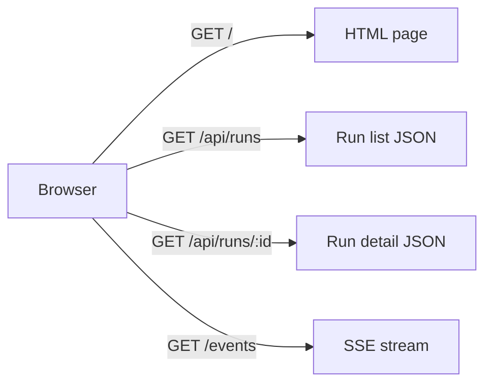
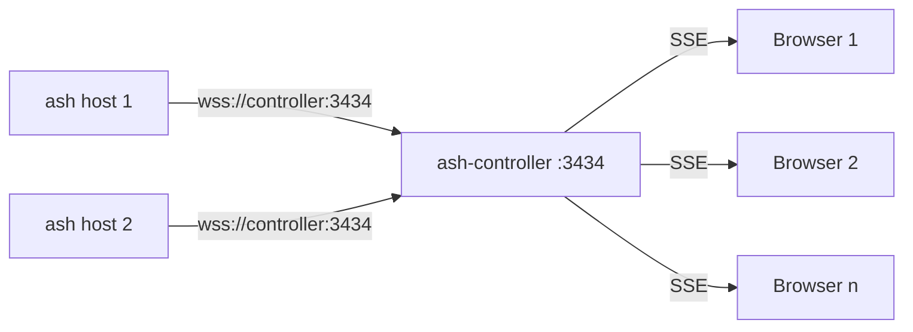

# Ash Controller

## Overview

The Ash Controller is a web application that receives telemetry events from `ash` in real-time and presents them as an execution dashboard — similar to GitHub Actions or Ansible Job output — accessible from a browser.

It is an **independent application** from `ash`, written in any language. The only coupling is the WebSocket protocol.

## Architecture



The controller serves HTTP (REST + SSE) and WebSocket on the same port. A single `axum` or equivalent server handles both.

## Protocol

### Transport

WebSocket, port 3434 (configurable). All messages are JSON text frames.

Messages use a `type` field for routing, with per-type payload fields. This is language-agnostic — any WebSocket library can participate.

### Message flow



### Message types

**ash → controller**

| `type` | Payload | Description |
|---|---|---|
| `hello` | `{"schema":"v1"}` | Sent first. Declares event JSON schema version. |
| `event` | Full `TelemetryEvent` JSON | A telemetry event. Same shape as written to the file. |
| `done` | `{}` | Script finished, no more events. |

**controller → ash**

| `type` | Payload | Description |
|---|---|---|
| `filter` | `{"rules":"..."}` | Tells ash what to send. Rules string format (e.g. `topic=agent*,agent!=echo`). Multiple `filter` messages replace the previous. |
| `error` | `{"message":"..."}` | Something wrong (unknown schema, protocol error). Ash closes the connection. |

### Filter semantics

- Controller sends `filter` to ash (not the other way around)
- Ash merges the controller's filter with its own local filter (intersection — event must pass both)
- If controller never sends a `filter`, ash uses its own local filter as the remote filter
- If controller sends an invalid rules string, ash ignores it and keeps the previous filter
- Controller can send a new `filter` at any point — user zooms in on specific agents/models mid-session

### Example session

```
→ ws://127.0.0.1:3434
→ {"type":"hello","schema":"v1"}
← {"type":"filter","rules":"topic=agent*"}
→ {"type":"event","trace_id":1,"span_id":1,"kind":"session_start",...}
→ {"type":"event","trace_id":1,"span_id":2,"kind":"agent_call",...}
→ {"type":"event","trace_id":1,"span_id":3,"kind":"agent_response",...}
← {"type":"filter","rules":"topic=agent*,agent=opencode"}
→ {"type":"event","trace_id":1,"span_id":4,"kind":"agent_call",...}
→ {"type":"done"}
→ close
```

## Config (ash side)

```yaml
telemetry:
  filter: "topic=agent*,payload:true"        # local filter — always applied
  file:
    path: ash-telemetry.jsonl
  controller:
    enabled: true
    url: "ws://127.0.0.1:3434"               # ws:// or wss://
    connect_timeout_ms: 2000
```

No `filter` in the controller config — the filter comes from the controller during the handshake. The local `telemetry.filter` controls what hits the file.

## Failure handling



The file is the durable source of truth. WebSocket push is best-effort. If the controller is unreachable, times out, or disconnects mid-stream, ash logs a debug message and continues — no data is lost because the file is always written.

## Controller server — HTTP endpoints



| Path | Method | Description |
|---|---|---|
| `/` | GET | Single-page HTML application |
| `/api/runs` | GET | List all runs |
| `/api/runs/:trace_id` | GET | Execution tree for one run |
| `/events` | GET | SSE stream of new events |

The WebSocket endpoint is at the same host:port — any path (e.g. `/ws`) or on upgrade.

## In-memory model (controller side)

```rust
struct Run {
    trace_id: u64,
    origin: String,
    started_at: u128,
    finished_at: Option<u128>,
    status: RunStatus,        // Running, Success, Failed
    agent_calls: u32,
    commands: u32,
    errors: u32,
    spans: Vec<Span>,
}

struct Span {
    span_id: u64,
    parent_span_id: Option<u64>,
    kind: String,
    agent: Option<String>,
    model: Option<String>,
    command: Option<String>,
    duration_ms: Option<u64>,
    status: StepStatus,       // Running, Success, Failed
    payload: serde_json::Value,
}
```

## Frontend

Single HTML page, no build tooling:

- **Run list**: table with timestamp, origin, duration, agent count, status badge
- **Run detail**: indented execution tree with color-coded spans (green/yellow/red)
- **Filter control**: controller sends `filter` updates to ash when the user changes the view
- **Auto-refresh**: SSE stream pushes new events to the currently viewed run
- **Tech stack**: vanilla HTML + CSS + JS

## Implementation options

| Language | Pros | Cons |
|---|---|---|
| Rust (Axum + tokio-tungstenite) | Same ecosystem, shared types | Build time |
| Go | Fast builds, stdlib WS support, simple deployment | Different toolchain |
| Python (FastAPI + websockets) | Quick to prototype | Runtime dependency, higher latency |
| Node.js (ws + express) | Large ecosystem, simple async | Runtime dependency |

No constraints — the protocol is just JSON over WebSocket. Any language works.

## Encryption

TLS via `wss://` for cross-machine deployments. Ash validates the controller's server certificate to confirm it's not an impostor.

### Config

```yaml
controller:
  enabled: true
  url: "wss://controller.internal:3434"
  tls:
    ca: /etc/ash/controller-ca.pem
```

### TLS modes

| Config | Behaviour |
|---|---|
| `url: ws://...` | Plain WebSocket. Use for localhost only. |
| `url: wss://...` | TLS WebSocket. Ash validates the server cert against the system CA or `tls.ca` if set. |
| `url: wss://...` + `tls.cert` + `tls.key` | mTLS. Controller also validates ash's client certificate. |

### mTLS

Two-way TLS with machine identity:

- Each machine has a key pair signed by a trusted CA
- Ash presents its client cert — controller knows which machine sent the events
- Controller presents its server cert — ash knows it's talking to the real controller
- The machine's hostname or unique ID in the certificate CN identifies the origin
- This replaces the `origin` field from the event payload (the cert already says who the machine is)

## Wire efficiency

JSON text frames are sparse (repeated keys, quotes, braces). Telemetry events are repetitive — every event carries `trace_id`, `span_id`, `kind`, `timestamp`, and similar-shaped payloads. Three approaches to tighten the wire format:

### Option 1: Permessage-deflate (recommended)

Standard WebSocket extension (RFC 7692). Compresses each frame's payload with deflate. Zero application-level changes:

| Side | Change |
|---|---|
| ash | `tungstenite` → enable permessage-deflate on connect |
| controller | Enable permessage-deflate on accept |

Typical compression ratio on repetitive event JSON: **3-5x**. No schema files, no extra dependencies, supported by every WebSocket library.

### Option 2: Binary frames + zstd

Send events as zstd-compressed bytes in binary WebSocket frames instead of JSON text frames. Control messages (`hello`, `filter`, `done`) stay as text frames.

```
ash → controller:
  text: {"type":"hello","schema":"v1","compress":"zstd"}
  ← text: {"type":"filter","rules":"..."}
  binary: <zstd-compressed event JSON>
  binary: <zstd-compressed event JSON>
  text: {"type":"done"}
```

| Metric | Value |
|---|---|
| Compression ratio | 5-10x |
| CPU cost | zstd is faster than deflate at equivalent levels |
| Deps | `zstd` crate (~pure Rust, no C dep) |

### Option 3: Protobuf schema

Define a `.proto` for the event types. Both sides serialize/deserialize against the compiled schema. Messages are sent as binary WebSocket frames. This is the most compact format but adds ceremony.

```
message TelemetryEvent {
  uint64 trace_id = 1;
  uint64 span_id = 2;
  optional uint64 parent_span_id = 3;
  string origin = 4;
  uint64 timestamp = 5;
  string kind = 6;
  bytes payload = 7;  // JSON-encoded payload for flexibility
}
```

| Metric | Value |
|---|---|
| Wire size | Smallest of all options (binary encoding with field tags) |
| Codegen | `prost` + protoc or `protobuf` crate |
| Schema evolution | Requires proto file changes + regeneration |

### Recommendation

Start with **permessage-deflate** (option 1). Zero code changes, standard extension, good compression. If the wire format needs to be even tighter later, the `hello` message can negotiate a compression scheme upgrade — the protocol is designed for it.

## Deployment



Single controller instance, many ash hosts connecting inbound. Load balancing at the network level (DNS round-robin, reverse proxy) is transparent to ash.

## Ash-side implementation estimate

| File | Change | Lines |
|---|---|---|
| `telemetry/config.rs` | Add `ControllerConfig` struct | +15 |
| `telemetry/pipeline.rs` | Spawn controller thread; `tx.try_send(event)` on emit | +30 |
| `telemetry/controller.rs` | NEW — WebSocket client: connect, hello, filter, stream, done | ~200 |
| `Cargo.toml` | `controller` feature flag; `tungstenite` dep | +5 |
