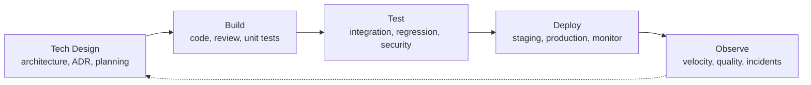

# Development Cycle

Nested inside the Product Cycle. Owns technical execution from architecture through deployment and operational observation.

---

## Phases

| Phase | Participants | Input | Activity | Output |
|-------|-------------|-------|----------|--------|
| Tech Design | Tech Lead / Architect, Software Engineers, DevOps / SRE | Design spec, system context, non-functional requirements | Architecture decisions, API contracts, database schema, infrastructure plan, task breakdown | Architecture Decision Record (ADR), technical design doc, sprint backlog |
| Build | Software Engineers | User stories, tech design, acceptance criteria | Write code, unit tests, peer review, integrate APIs | Committed code, passing unit tests, reviewed pull requests |
| Test | QA Engineer, Security Engineer, Software Engineers | Release candidate, acceptance criteria | Integration testing, regression testing, performance testing, penetration scan, vulnerability audit | Test report, bug tracker updates, security report, QA sign-off |
| Deploy | DevOps / SRE, QA Engineer, Engineering Manager | Approved release, deployment plan | Staging validation, smoke tests, production deployment, feature flag toggle, monitoring | Deployed production, runbook updates, deployment announcement |
| Observe | Software Engineers, QA, DevOps / SRE | Error budgets, cycle time, deployment frequency, incident rate | Retrospective, process improvement, tech debt planning, reliability engineering | Improvement backlog, velocity metrics, reliability reports |

---

## Activity Assessment

| Phase | Execution vs Exploration | AI Suitability | Key Methodology | Key Decisions | Key Human Input | Key Performance Indicators |
|-------|-------------------------|----------------|-----------------|---------------|-----------------|---------------------------|
| Tech Design | 40% execution / 60% exploration | Medium-High — architecture recommendations from requirements, API specification generation, dependency analysis, but trade-off judgment remains human | ADR (Architecture Decision Records), domain-driven design, design patterns, RFC / proposal process, C4 model | Technology choices, architecture style, API contracts, database schema, infrastructure topology | Architecture trade-off judgment, long-term maintainability intuition, risk decision on unproven approaches | ADR adoption rate, rework due to design gaps, design review cycle time, architecture compliance score |
| Build | 80% execution / 20% exploration | High — code generation, auto-completion, refactoring, static analysis, PR review suggestions, test writing | TDD, code review (paired / async), pair / mob programming, trunk-based development, conventional commits | Implementation approach, abstraction boundaries, naming, testing scope | Edge case discovery, creative problem-solving, nuanced code review judgment, debugging intuition | Cycle time (commit to deploy), code churn rate, PR merge rate, review turnaround time |
| Test | 60% execution / 40% exploration | High — test case generation from acceptance criteria, visual regression detection, security vulnerability scanning, performance test automation | Shift-left testing, automated testing pyramid, risk-based testing, property-based testing, chaos engineering | What to test at each level, release quality bar, risk acceptance | Risk assessment intuition, exploratory testing creativity, scenario generation based on production knowledge | Test coverage %, defect escape rate, false positive rate, test execution time |
| Deploy | 90% execution / 10% exploration | High — CI/CD pipeline management, canary analysis, auto-rollback on failure, infrastructure provisioning | Infrastructure as code (Terraform / Pulumi), immutable infrastructure, canary / blue-green deployments, feature flags | Rollout strategy (percentage, rings), rollback triggers, release window | Rollback judgment under pressure, deployment timing based on business context, incident communication tone | Change failure rate, deployment frequency, rollback rate, time from merge to production |
| Observe | 20% execution / 80% exploration | High — monitoring dashboards, anomaly detection, log pattern analysis, root cause correlation, error budget tracking | Observability (logs, metrics, traces), SLO / SLI / error budgets, reliability engineering, retrospectives | Tech debt priorities, reliability investments, on-call rotation changes, process improvements | Incident triage judgment, reliability investment balance, on-call escalation discernment, retrospective facilitation | MTTD (time to detect), MTTR (time to resolve), error budget burn rate, alert-to-ticket conversion |

---

## I/O With Other Cycles

| Direction | Partner Cycle | Signal | KPI |
|-----------|--------------|--------|-----|
| Incoming | Product | Design spec, acceptance criteria, priorities | Spec clarity score, criteria completeness, priority stability |
| Outgoing | Product | Feasibility estimates, delivery timelines, quality data | Estimate accuracy (±%), delivery predictability, quality data timeliness |
| Outgoing | Operations / Support | Hotfixes, patch releases, known issues, runbook updates | Patch deployment latency, runbook accuracy, known-issue documentation completeness |
| Incoming | Operations / Support | Bug reports, escalation patterns | Report quality score, escalation relevance rate, pattern reproducibility |
| Outgoing | Strategic | Incident trends, post-mortems | Report actionability, trend clarity, post-mortem quality score |

---

## External I/O

| Direction | Source / Target | Signal | KPI |
|-----------|----------------|--------|-----|
| Incoming | Open source ecosystem | Library updates, security patches, license changes, deprecation notices | Dependency freshness score, vulnerability patching SLA, license compliance rate |
| Incoming | Cloud / infrastructure providers | Service releases, pricing changes, region availability, quota limits | Provider SLA adherence, cost change impact accuracy, capacity utilisation rate |
| Incoming | CI/CD platforms | Build status, test results, artifact storage | Build reliability, test execution accuracy, artifact retention compliance |
| Incoming | Security advisory feeds | CVE announcements, zero-day disclosures, dependency vulnerabilities | Advisory-to-patch time, vulnerability coverage, false positive rate |
| Outgoing | Production environment | Deployed software, configuration changes, infrastructure updates | Deployment success rate, config drift detection, infrastructure consistency score |
| Outgoing | API consumers | API endpoints, SDK / library releases, integration documentation | API uptime, SDK adoption rate, documentation completeness score |
| Outgoing | Open source community | Code contributions, pull requests, issue discussions | Contribution acceptance rate, community response time, issue resolution rate |
