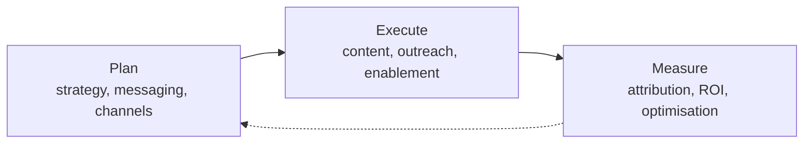

# Launch & Marketing Cycle

Parallel to the Product Cycle at the Strategic level. Plans and executes campaigns, measures market response, and feeds positioning insights back to Product.

---

## Phases

| Phase | Participants | Input | Activity | Output |
|-------|-------------|-------|----------|--------|
| Plan | Marketing Team, Product Marketing | Release notes, roadmap, target segments, competitive positioning | Campaign strategy, channel selection, messaging development | Campaign plan, positioning document, sales enablement plan |
| Execute | Marketing, Sales, Product Marketing | Campaign plan | Content creation, press releases, demo recording, landing pages, outreach | Launched campaign, sales deck, demo videos, blog posts |
| Measure | Marketing, Data / Analytics | Campaign reach, conversion funnel, pipeline generated | Attribution analysis, ROI assessment, A/B test evaluation | Campaign report, lessons learned, optimisation recommendations |

---

## Activity Assessment

| Phase | Execution vs Exploration | AI Suitability | Key Methodology | Key Decisions | Key Human Input | Key Performance Indicators |
|-------|-------------------------|----------------|-----------------|---------------|-----------------|---------------------------|
| Plan | 30% execution / 70% exploration | Medium-High — audience segmentation analysis, channel performance prediction, messaging variant generation | Messaging matrix, channel strategy, TAM/SAM/SOM analysis, persona-based targeting | Positioning, core messaging, channel mix, budget allocation | Brand voice definition, creative vision, non-obvious audience insights, competitive intuition | Campaign ROI prediction accuracy, time-to-plan, audience targeting precision |
| Execute | 80% execution / 20% exploration | High — content generation (copy, images, video), personalisation at scale, scheduling and sequencing, A/B variant creation | Campaign management, marketing automation, agile marketing sprints | Creative approval, spend allocation, timing and sequencing | Brand alignment judgment, creative direction, relationship-based outreach, crisis handling | Campaign reach, conversion rate, MQL/SQL generated, content production velocity |
| Measure | 30% execution / 70% exploration | High — attribution modeling, funnel anomaly detection, sentiment analysis, automated reporting | Attribution modeling (multi-touch, last-touch), funnel analysis, A/B testing, cohort analysis | Optimisation priorities, budget reallocation, campaign go/no-go | Business context for attribution interpretation, qualitative market insight, strategic narrative | Attribution accuracy, reporting latency, optimisation iteration speed, ROI per channel |

---

## I/O With Other Cycles

| Direction | Partner Cycle | Signal | KPI |
|-----------|--------------|--------|-----|
| Incoming | Strategic | Corporate direction, release cadence, target markets | Brief-to-campaign latency, direction alignment score |
| Incoming | Product | Feature details, release schedule, value propositions | Feature accuracy in messaging, schedule adherence impact |
| Outgoing | Strategic | Campaign performance reports | Report timeliness, data accuracy vs actuals |
| Outgoing | Product | Market response data, positioning requirements, customer feedback themes | Feedback incorporation rate, insight-to-action time |

---

## External I/O

| Direction | Source / Target | Signal | KPI |
|-----------|----------------|--------|-----|
| Incoming | Target audience, market | Segment preferences, channel consumption habits, brand sentiment | Insight relevance rate, signal-to-noise ratio |
| Incoming | Advertising platforms | Campaign reach, CPM/CPC, conversion data, audience insights | Data accuracy, refresh frequency, API reliability |
| Incoming | Media / press | Editorial coverage, influencer relationships, award eligibility | Coverage sentiment score, influencer engagement rate |
| Outgoing | Target audience | Advertising, content (blog, video, social), email campaigns | Engagement rate, click-through rate, conversion attribution |
| Outgoing | Press / analysts | Press releases, media briefings, product announcements | Media pickup rate, analyst coverage quality |
| Outgoing | Sales channel | Sales enablement materials, demo environments, case studies | Sales enablement NPS, content utilisation rate |
| Outgoing | Events / conferences | Speaking sessions, exhibition presence, networking | Lead generation per event, pipeline influenced |
