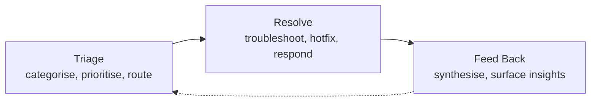

# Operations / Support & Maintenance Cycle

Handles the live product. Triages and resolves incidents, feeds bug reports and feature requests into Product Discovery. Receives hotfixes and patches from Development.

---

## Phases

| Phase | Participants | Input | Activity | Output |
|-------|-------------|-------|----------|--------|
| Triage | Customer Support, SRE / DevOps | User tickets, monitoring alerts, escalation requests | Prioritise, categorise, route to appropriate resolver | Triaged queue, severity assignments, SLA tracking |
| Resolve | Support, SRE, Software Engineers | Assigned tickets, incident alerts | Troubleshooting, hotfixes, incident response, root-cause analysis | Resolved tickets, incident reports, post-mortems |
| Feed Back | Customer Support, Customer Success, Product Manager | Ticket patterns, feature requests, usage bottlenecks | Synthesise themes, surface actionable insights to Product Cycle | Insight reports, product feedback, trend analysis |

---

## Activity Assessment

| Phase | Execution vs Exploration | AI Suitability | Key Methodology | Key Decisions | Key Human Input | Key Performance Indicators |
|-------|-------------------------|----------------|-----------------|---------------|-----------------|---------------------------|
| Triage | 70% execution / 30% exploration | High — auto-categorisation by intent/severity, sentiment detection, suggested responses, routing optimisation | ITIL / ITSM framework, SLA management, priority matrix (impact × urgency), RACI | Severity level, escalation path, SLA target | Customer empathy in nuanced situations, complex escalation handling, policy exceptions | MTTR (time to triage), SLA compliance %, first-response time, auto-triage accuracy |
| Resolve | 60% execution / 40% exploration | Medium-High — diagnostic suggestion based on similar incidents, automated remediation playbooks, root cause correlation | Incident management (ITIL), blameless post-mortems, root cause analysis (5 whys, fishbone), runbooks | Fix strategy (hotfix vs patch vs workaround), rollback decision, communication scope | Novel incident debugging, cross-system intuition, customer communication tone, risk judgment under time pressure | MTTR (time to resolve), incident recurrence rate, customer satisfaction with resolution, fix success rate |
| Feed Back | 20% execution / 80% exploration | High — pattern detection across tickets, trend synthesis, automatic prioritisation of product gaps | Trend analysis, root cause categorisation, sentiment tracking, closed-loop feedback | What to escalate to Product, priority and severity classification, feature request triage | Strategic prioritisation of what to escalate, connecting pattern to business impact, long-running context memory | Actionable insight rate, feedback cycle time, Product team adoption of insights, trend detection lead time |

---

## I/O With Other Cycles

| Direction | Partner Cycle | Signal | KPI |
|-----------|--------------|--------|-----|
| Outgoing | Product | Bug patterns, feature requests, usage friction, trend analysis | Insight relevance score, Product adoption rate of feedback, escalation-to-action time |
| Incoming | Product / Development | Hotfixes, patch releases, known issues, runbook updates | Patch deployment timeliness, runbook accuracy, known-issue communication latency |

---

## External I/O

| Direction | Source / Target | Signal | KPI |
|-----------|----------------|--------|-----|
| Incoming | End users | Support tickets, feature requests, bug reports, usage questions | Ticket volume trend, first-contact resolution potential, channel distribution |
| Incoming | Infrastructure providers | Monitoring alerts, uptime notifications, resource utilisation | Alert accuracy rate, false positive rate, notification latency |
| Incoming | Security researchers | Vulnerability disclosures, responsible disclosure reports | Disclosure-to-triage time, researcher satisfaction score |
| Incoming | Third-party vendors | Service degradation notices, API deprecation, license changes | Vendor response time, impact assessment accuracy |
| Outgoing | End users | Resolved tickets, status updates, knowledge base articles, incident communications | CSAT per resolution, knowledge base utilisation rate, incident communication clarity |
| Outgoing | Public | Service status page, uptime reports, security advisories | Status page accuracy, uptime reporting timeliness, advisory clarity score |
