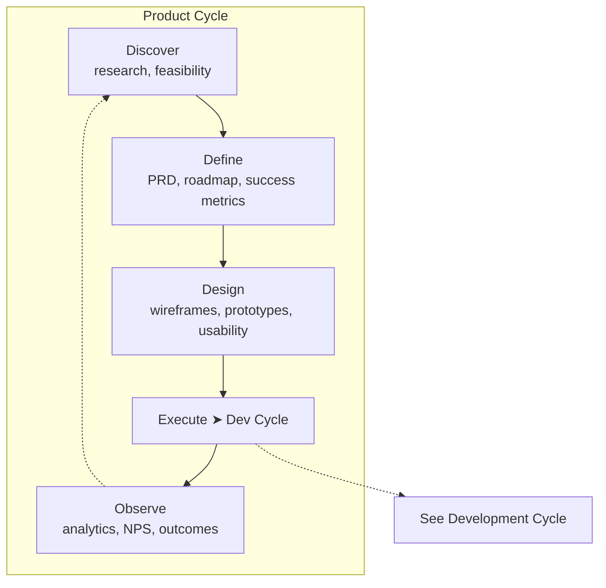

# Product Cycle

Drives feature delivery from discovery through release and outcome measurement. Delegates technical execution to the [Development Cycle](development_cycle.md).

---

## Phases

| Phase | Participants | Input | Activity | Output |
|-------|-------------|-------|----------|--------|
| Discover | Product Manager, UX Researcher, Tech Lead | Strategic objectives, support insights, market data, analytics | Problem framing, user interviews, surveys, competitive analysis, feasibility assessment | Research report, personas, user journey maps, opportunity assessment |
| Define | Product Manager, Product Director | Research findings, strategic constraints | Product brief, PRD, success metrics, hypotheses, prioritisation | Prioritised roadmap, feature hypotheses, OKRs |
| Design | UX / UI Designer, Product Manager | PRD, personas | Wireframes, information architecture, visual design, prototypes, usability testing | Approved design spec, design system updates |
| Execute | PM, Designers, Engineers, QA, DevOps | Design spec, acceptance criteria | [Delegates to Development Cycle](development_cycle.md) → Release to production | Delivered feature, release notes, feature flags |
| Observe | Product Manager, Data / Analytics | Usage analytics, satisfaction surveys, NPS | Outcome vs hypothesis analysis, funnel metrics, qualitative feedback | Learning report, iteration candidates, roadmap refresh |

---

## Activity Assessment

| Phase | Execution vs Exploration | AI Suitability | Key Methodology | Key Decisions | Key Human Input | Key Performance Indicators |
|-------|-------------------------|----------------|-----------------|---------------|-----------------|---------------------------|
| Discover | 20% execution / 80% exploration | Medium — interview synthesis, competitive analysis scanning, pattern detection across research data, but problem framing requires human judgment | Design thinking, jobs-to-be-done, user research (contextual inquiry, diary studies), competitive analysis | Problem to solve, target users, market opportunity, go/no-go | Problem framing empathy, research question design, interpreting unspoken user needs, bias detection | Research velocity (insights per sprint), user need validation rate, confidence in problem definition |
| Define | 40% execution / 60% exploration | Medium — data analysis for prioritisation, hypothesis generation, OKR drafting, but trade-off decisions are inherently human | OKR / SMART goals, hypothesis-driven development, RICE / WSJF prioritisation, opportunity solution trees | Scope, priorities, success metrics, target outcomes | Stakeholder negotiation, strategic trade-offs, vision articulation, organisational alignment | Roadmap predictability (% on time), feature success rate (% meeting outcome), prioritisation satisfaction score |
| Design | 50% execution / 50% exploration | Medium-High — UI generation, design system component assembly, prototype creation, usability test automation | Iterative design, design systems, usability testing (formative / summative), accessibility standards (WCAG) | Design direction, interaction patterns, information architecture, visual language | Creative direction, brand consistency, inclusive design judgment, aesthetic taste | Design iteration cycle time, usability defect rate, design-to-dev handoff clarity score |
| Execute | 85% execution / 15% exploration | Medium — progress tracking, coordination, status reporting; execution itself is delegated to Development Cycle | Agile (Scrum / Kanban), continuous delivery, project management, dependency management | Go/no-go for release, scope trade-offs, rollback decision | Go/no-go judgment under uncertainty, scope negotiation, stakeholder communication | Delivery predictability (planned vs actual), lead time, scope change frequency |
| Observe | 20% execution / 80% exploration | High — anomaly detection in metrics, funnel analysis automation, sentiment analysis on feedback, cohort comparison | Outcome-driven development, funnel analysis, cohort analysis, customer satisfaction tracking (NPS / CSAT) | Iterate, pivot, or stop; next hypothesis; roadmap refresh | Context-rich metric interpretation, connecting quantitative signal to qualitative context, long-term product intuition | Metric-to-action conversion rate, learning cycle time, data-informed decision % |

---

## I/O With Other Cycles

| Direction | Partner Cycle | Signal | KPI |
|-----------|--------------|--------|-----|
| Incoming | Strategic | OKRs, budget allocation, constraints, strategic priorities | OKR alignment score, constraint clarity rating, goal cascade accuracy |
| Outgoing | Strategic | Outcome reports, adoption metrics, portfolio health | Report timeliness, metric accuracy, insight actionability by exec |
| Outgoing | Launch & Marketing | Feature details, release schedule, value propositions | Schedule accuracy, feature detail completeness, last-minute change frequency |
| Incoming | Launch & Marketing | Market response data, positioning requirements, customer feedback themes | Feedback incorporation rate, market signal relevance, positioning alignment |
| Incoming | Operations / Support | Bug patterns, feature requests, usage friction, trend analysis | Pattern-to-backlog conversion rate, feedback freshness, actionability score |
| Outgoing | Operations / Support | Hotfixes, patch releases, known issues, runbook updates | Patch deployment timeliness, known-issue documentation quality |
| Incoming | Development | Feasibility estimates, delivery timelines, quality data | Estimate accuracy, quality data completeness, delivery predictability |
| Outgoing | Development | Design spec, acceptance criteria, priorities | Spec clarity score, criteria completeness, priority stability |

---

## External I/O

| Direction | Source / Target | Signal | KPI |
|-----------|----------------|--------|-----|
| Incoming | Target users | User research participants, interview responses, survey answers, usability test sessions | Recruitment velocity, response rate, participant diversity score |
| Incoming | Competitive landscape | Competitor product changes, market positioning shifts, pricing changes | Intelligence timeliness, competitive coverage breadth |
| Incoming | Third-party platforms | Usage analytics, app store ratings, NPS survey responses | Data freshness, survey response rate, data accuracy |
| Outgoing | End users | Released features, Changelog / release notes, product documentation, beta invitations | Feature adoption rate, documentation utilisation, beta participation rate |
| Outgoing | Developer community | API changelogs, SDK releases, technical documentation | Developer satisfaction (DSAT), API adoption rate, documentation clarity |
| Outgoing | Design community | Design system contributions, open-source design assets | Contribution adoption rate, community engagement, design system usage spread |
