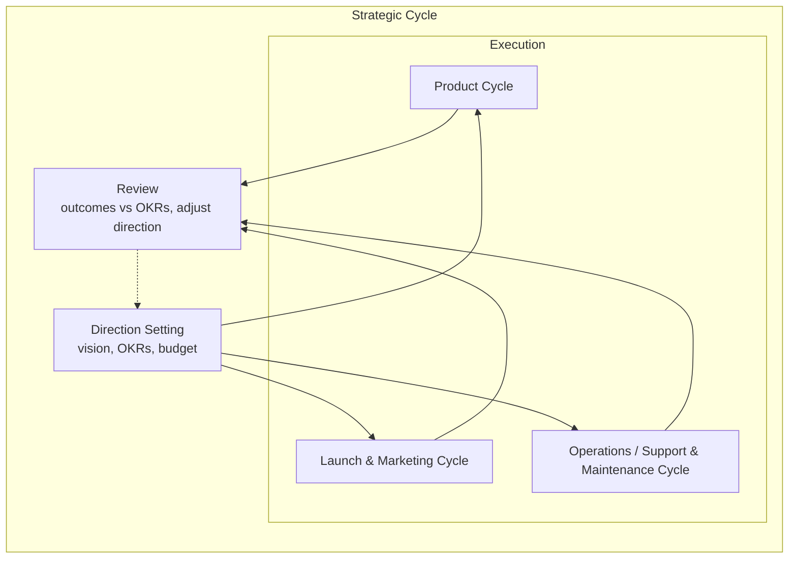

# Strategic Cycle

The top-level container cycle. Contains all sub-cycles and is fundamentally dependent on their execution. Sets direction, reviews outcomes, and adjusts — but cannot achieve its OKRs if sub-cycles cannot deliver.

---

## Contained Sub-Cycles

The Strategic Cycle contains the following sub-cycles. Each receives constraints from Direction Setting and feeds outcomes to Review. The Strategic Cycle is **blocked** if any sub-cycle cannot deliver against its commitments.

| Sub-Cycle                                                       | Role                                                                           | Receives From Direction Setting                      | Feeds To Review                                       | Blocks Strategic When                                                               |
| --------------------------------------------------------------- | ------------------------------------------------------------------------------ | ---------------------------------------------------- | ----------------------------------------------------- | ----------------------------------------------------------------------------------- |
| [Product Cycle](product_cycle.md)                               | Drives feature delivery from discovery through release and outcome measurement | OKRs, budget, strategic priorities                   | Outcome reports, adoption metrics, portfolio health   | Can't deliver on OKRs — forces scope cut or timeline reset                          |
| [Launch & Marketing Cycle](launch_marketing_cycle.md)           | Plans and executes go-to-market campaigns, measures market response            | Target markets, corporate direction, release cadence | Campaign performance, pipeline, revenue attribution   | Campaigns fail to generate pipeline — revenue targets miss                          |
| [Operations / Support & Maintenance Cycle](operations_cycle.md) | Triages and resolves incidents, maintains live product health                  | Strategic support priorities                         | Incident trends, stability metrics, customer insights | Incident volume overwhelms — Product velocity stalls, commitments slip              |
| [Development Cycle](development_cycle.md)                       | Nested inside Product. Owns execution from architecture through deployment     | Priorities indirectly via Product                    | Incident trends, post-mortems                         | Technical feasibility impossible — Product scope must shrink, outcomes unattainable |

---

## Phases

| Phase             | Participants                       | Input                                                                                        | Activity                                                                                                             | Output                                                                              |
| ----------------- | ---------------------------------- | -------------------------------------------------------------------------------------------- | -------------------------------------------------------------------------------------------------------------------- | ----------------------------------------------------------------------------------- |
| Direction Setting | Board of Directors, CEO, Exec Team | Market trends, financial reports, portfolio health                                           | Set corporate vision, mission, OKRs, budget allocation, risk appetite                                                | Strategic plan, funding decisions, annual goals, sub-cycle mandates                 |
| Review            | Board of Directors, CEO            | Sub-cycle outcome reports, portfolio dashboards, financial results, competitive intelligence | Assess outcomes against OKRs, evaluate whether Product delivery enabled or blocked strategic goals, adjust direction | Updated strategic plan, pivots, reprioritised OKRs, resource reallocation decisions |

---

## Activity Assessment

| Phase             | Execution vs Exploration        | AI Suitability                                                                                                              | Key Methodology                                                                                           | Key Decisions                                                                        | Key Human Input                                                                                        | Key Performance Indicators                                                                               |
| ----------------- | ------------------------------- | --------------------------------------------------------------------------------------------------------------------------- | --------------------------------------------------------------------------------------------------------- | ------------------------------------------------------------------------------------ | ------------------------------------------------------------------------------------------------------ | -------------------------------------------------------------------------------------------------------- |
| Direction Setting | 20% execution / 80% exploration | Medium — can synthesise market data, model scenarios, but value-based strategy judgments remain human                       | SWOT / PESTLE analysis, OKR setting, scenario planning, blue ocean strategy                               | Corporate vision, OKRs, risk appetite, budget allocation, sub-cycle mandates         | Vision articulation, value-based strategy trade-offs, risk appetite definition, long-horizon intuition | OKR attainment rate, strategic forecast accuracy, sub-cycle delivery enablement                          |
| Review            | 30% execution / 70% exploration | High — anomaly detection in portfolio metrics, trend analysis, competitive signal monitoring, sub-cycle outcome correlation | OKR review, variance analysis, balanced scorecard, strategy review cadence, sub-cycle dependency tracking | Pivots, strategic adjustments, OKR refresh, re-prioritisation, resource reallocation | Qualitative interpretation of ambiguous signals, board-level discernment, conviction under uncertainty | Pivot velocity, strategic decision accuracy, review cadence adherence, sub-cycle blockage detection time |

---

## I/O With Sub-Cycles (inside the Strategic container)

| Direction                    | Sub-Cycle          | Signal                                                           | KPI                                                                               |
| ---------------------------- | ------------------ | ---------------------------------------------------------------- | --------------------------------------------------------------------------------- |
| Outgoing (Direction Setting) | Product            | OKRs, budget allocation, constraints, strategic priorities       | OKR alignment rate, signal clarity score, decision incorporation time             |
| Outgoing (Direction Setting) | Launch & Marketing | Corporate direction, release cadence, target markets             | Direction-to-campaign latency, brief completeness score                           |
| Outgoing (Direction Setting) | Operations         | Support priorities, incident response SLAs                       | Priority clarity score                                                            |
| Incoming (Review)            | Product            | Outcome reports, adoption metrics, portfolio health              | Report timeliness, data completeness, insight actionability rate                  |
| Incoming (Review)            | Launch & Marketing | Campaign performance, pipeline attribution, revenue contribution | Report accuracy vs actuals, reporting cadence adherence                           |
| Incoming (Review)            | Development        | Incident trends, post-mortems, technical feasibility constraints | Escalation relevance rate, post-mortem quality score, early blockage warning time |

---

## External I/O (boundary of the Strategic container)

These are signals that cross the boundary of the Strategic Cycle — inputs from and outputs to the outside world.

| Direction | Source / Target                 | Signal                                                           | KPI                                                                  |
| --------- | ------------------------------- | ---------------------------------------------------------------- | -------------------------------------------------------------------- |
| Incoming  | Financial markets, shareholders | Investor expectations, funding availability, valuation signals   | Signal accuracy vs market realisation, intelligence-to-decision time |
| Incoming  | Industry analysts, media        | Market intelligence, competitive positioning, regulatory changes | Intelligence relevance rate, early warning lead time                 |
| Incoming  | Regulatory bodies               | Compliance requirements, data privacy mandates, licensing        | Compliance response time, audit pass rate                            |
| Outgoing  | Investor community              | Annual reports, earnings calls, strategic communications         | Investor satisfaction score, communication clarity rating            |
| Outgoing  | General public                  | Corporate messaging, brand positioning, ESG reporting            | Brand sentiment change, message recall rate                          |
| Outgoing  | Regulators                      | Compliance filings, audit submissions                            | Filing accuracy rate, submission timeliness                          |
